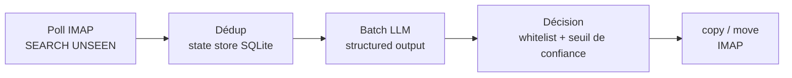

# Email Zero

[](https://github.com/MaximeWoirin/email-zero/actions/workflows/ci.yml)
[](https://github.com/MaximeWoirin/email-zero/actions/workflows/docker.yml)
[](https://github.com/MaximeWoirin/email-zero/actions/workflows/codeql.yml)

Pré-traitement d'emails par IA, headless, en Rust : un worker qui lit les nouveaux
mails en IMAP, les fait évaluer par un LLM (catégorie, criticité, résumé) et
écrit le tri directement dans les dossiers de la boîte. Le client mail habituel
reste l'interface unique — pas d'UI.

**Pour qui / pourquoi** : pour qui veut garder une boîte de réception lisible sans
y passer ses soirées — le tri se fait dans les dossiers existants de la boîte, donc
visible depuis n'importe quel client mail, sans nouvel outil à ouvrir.

Le badge CI couvre `cargo fmt --check`, `cargo clippy -D warnings`, `cargo test`
et les deux étages en conteneur (`imap-dovecot`, `llm-litellm`) ; le badge Docker
couvre le build `linux/arm64` et le smoke `--version` sous QEMU.

## Comment ça marche

Un daemon poll chaque boîte configurée, en cinq étapes :



1. **Poll** : `SEARCH UNSEEN` sur INBOX. Tous les fetchs passent en `BODY.PEEK[]` :
   le flag `\Seen` n'est jamais posé.
2. **Dédup** : les UIDs déjà traités (state store SQLite, scopés par `UIDVALIDITY`)
   sont exclus — on cible les mails « non traités », pas « nouveaux ».
3. **Évaluation LLM** : les mails sont envoyés par batchs de `batch_size` à un
   endpoint OpenAI-compatible (LiteLLM…) en structured output, et réassociés par
   leur `uid` embarqué dans le prompt.
4. **Décision** (contrat de triage v2) : le LLM renvoie par mail une liste ordonnée
   de dossiers plausibles (`candidates`) ; le moteur retient le meilleur candidat
   de la whitelist (confiance max, égalité → le premier de la liste). Si cette
   confiance est sous le seuil configuré, le mail reste dans INBOX.
5. **Action** : `copy` (défaut) ou `move` vers le dossier retenu, puis persistance
   dans le state store. `--dry-run` évalue et affiche sans rien écrire.

## Ce qu'Email Zero ne fait pas

- Jamais d'envoi de mail.
- Jamais de `\Seen` : aucun flag n'est modifié, les mails restent non lus.
- Jamais de création de dossier : la cible doit appartenir à la whitelist découverte.
- Pas d'UI : le client mail habituel reste l'interface.
- Pas de perte de mail : l'action par défaut est la copie, jamais la suppression.

## Docs

- [Architecture](docs/architecture.md) — composants, contrat de triage v2, stratégie de tests
- [Configuration](docs/configuration.md) — référence complète du TOML, secrets, déploiement
- [Spec design v1](docs/superpowers/specs/2026-11-01-email-zero-design.md) — référence de conception

## Démarrage rapide

```sh
cp config.example.toml config.toml   # puis renseigner les noms de variables d'env
cargo run -- --config config.toml --dry-run --once
```

Voir [docs/configuration.md](docs/configuration.md) pour la référence complète du
fichier TOML et la gestion des secrets.

## Référence CLI

`--help` (généré par clap) reste la source des options ; cette section documente la
sémantique, pas un copié-collé.

| Option | Défaut | Sémantique |
|--------|--------|------------|
| `--config <chemin>` | `config.toml` | Chemin du fichier de config TOML. |
| `--dry-run` | off | Évalue et affiche les actions prévues sans rien écrire sur le serveur. |
| `--once` | off | Une seule exécution puis sortie (manuel, cron, timer systemd). |
| `--refresh-folders` | off | Force le rafraîchissement des profils de dossiers. |
| `--version`, `--help` | — | Générés par clap. |

**Combinaisons** :

- `--dry-run --once` = **smoke de référence** : un seul poll, aucune écriture —
  c'est la commande du smoke avant le premier run réel.
- **Daemon** (sans `--once`) : sommeil entre deux tours = min des
  `poll_interval_secs` des boîtes ; chaque boîte est **reconnectée à chaque
  itération** (une session inactive est déconnectée par le serveur entre deux polls) ;
  l'échec d'une boîte est logué et **isolé**, il n'arrête pas le daemon.

**Variables d'environnement** : `RUST_LOG` a la **priorité** sur `[log].level` quand
elle est définie ; les secrets (`EZ_*`) sont résolus via `password_env` /
`password_cmd` (voir [docs/configuration.md](docs/configuration.md)).

## Déployer (POC conteneur, cible Pi 3 B+ arm64)

```sh
cp config.example.toml config.toml        # boîte "proton" : host = "bridge", port = 1143, tls = false
cp .env.example .env && chmod 600 .env    # EZ_ORANGE_PASSWORD, EZ_PROTON_PASSWORD (app password Bridge), EZ_LLM_API_KEY
install -d -o 10001 -g 10001 data          # propriétaire = user non-root du conteneur
docker compose run --rm bridge init       # ajouter le compte Proton dans Bridge (interactif)
docker compose run --rm email-zero --config /config/config.toml --dry-run --once   # smoke : aucune écriture
docker compose up -d                      # daemon
docker compose logs -f email-zero         # logs JSON
```

Build de l'image seule :
`docker buildx build --platform linux/arm64 -t email-zero:local --load .`

## Développement

```sh
cargo test                             # unitaires + intégration, zéro réseau externe
# étage conformité RFC (client réel contre Dovecot, job CI `imap-dovecot`) :
cargo test --test imap_dovecot -- --ignored
# étage E2E LLM (client réel contre le proxy LiteLLM réel, job CI `llm-litellm`) :
cargo test --test llm_litellm -- --ignored
```

Philosophie : TDD stricte (aucune ligne de production sans test qui échoue d'abord),
frontières externes (IMAP, LLM) en traits injectés (`src/ports.rs`), mockés dans les
tests d'intégration.

**Cinq niveaux de tests** (détails et architecture des étages CI dans
[docs/architecture.md](docs/architecture.md)) :

1. **Unitaires** : parsing config, logique `UIDVALIDITY`, whitelist, seuil de confiance.
2. **Intégration** : pipeline complet avec fake IMAP + fake LLM scripté, zéro réseau.
3. **Conformité RFC (CI)** : le vrai client IMAP contre un vrai serveur Dovecot en
   conteneur, publié sur le loopback uniquement.
4. **E2E LLM (CI)** : le vrai client LLM contre un vrai proxy LiteLLM configuré en
   `mock_response`, publié sur le loopback uniquement.
5. **Smoke réel (manuel, hors CI)** : `--dry-run --once` contre les vraies boîtes —
   jamais d'écriture ni de secret en CI.
