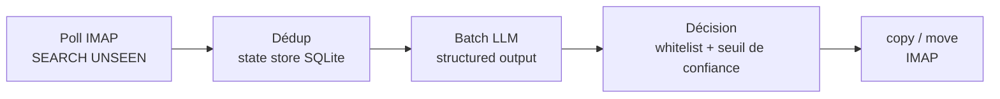

# Email Zero

[](https://github.com/MaximeWoirin/email-zero/actions/workflows/ci.yml)
[](https://github.com/MaximeWoirin/email-zero/actions/workflows/docker.yml)
[](https://github.com/MaximeWoirin/email-zero/actions/workflows/codeql.yml)

Pré-traitement d'emails par IA, headless, en Rust : un worker qui lit les nouveaux
mails en IMAP, les fait évaluer par un LLM (catégorie, criticité, résumé) et écrit
le tri directement dans les dossiers existants de la boîte. Le client mail habituel
reste l'interface unique — pas d'UI, pas de nouvel outil à ouvrir.

## Comment ça marche

Un daemon poll chaque boîte configurée, en cinq étapes :



1. **Poll** : `SEARCH UNSEEN` sur INBOX. Tous les fetchs passent en `BODY.PEEK[]` :
   le flag `\Seen` n'est jamais posé.
2. **Dédup** : les UIDs déjà traités (state store SQLite, scopés par `UIDVALIDITY`)
   sont exclus — on cible les mails « non traités », pas « nouveaux ».
3. **Évaluation LLM** : les mails sont envoyés par batchs de `batch_size` à un
   endpoint OpenAI-compatible en structured output, et réassociés par leur `uid`.
4. **Décision** : le LLM renvoie par mail une liste ordonnée de dossiers plausibles ;
   le moteur retient le meilleur candidat appartenant à la whitelist des dossiers
   découverts. Sous le seuil de confiance configuré, le mail reste dans INBOX.
5. **Action** : `copy` (défaut) ou `move` vers le dossier retenu, puis persistance
   dans le state store. `--dry-run` évalue et affiche sans rien écrire.

## Ce qu'Email Zero ne fait pas

- Jamais d'envoi de mail.
- Jamais de `\Seen` : aucun flag n'est modifié, les mails restent non lus.
- Jamais de création de dossier : la cible doit appartenir à la whitelist découverte.
- Pas d'UI : le client mail habituel reste l'interface.
- Pas de perte de mail : l'action par défaut est la copie, jamais la suppression.

## Démarrage rapide

```sh
cp config.example.toml config.toml   # renseigner les noms de variables d'env
cargo run -- --config config.toml --dry-run --once
```

Au premier lancement, `--dry-run --once` fait un passage complet sans aucune
écriture : vérifiez les décisions dans les logs avant d'activer le tri. La
référence complète du fichier TOML (boîtes, LLM, triage, secrets) est dans
[docs/configuration.md](docs/configuration.md).

## Référence CLI

`--help` (généré par clap) reste la source des options ; cette section documente la
sémantique, pas un copié-collé.

| Option | Défaut | Sémantique |
|--------|--------|------------|
| `--config <chemin>` | `config.toml` | Chemin du fichier de config TOML. |
| `--dry-run` | off | Évalue et affiche les actions prévues sans rien écrire sur le serveur. |
| `--once` | off | Une seule exécution puis sortie (manuel, cron, timer systemd). |
| `--refresh-folders` | off | Force le rafraîchissement des profils de dossiers. |
| `--list-folders` | off | Affiche l'état des dossiers du state store (source `llm`/`user`, whitelist, description, exemples, `updated_at`) puis quitte — sans connexion IMAP ni LLM. |
| `--describe-folder <DOSSIER>` | off | Définit manuellement la description d'un dossier (affiche l'état actuel, puis enregistre la nouvelle description en source `user`) puis quitte. |
| `--describe-text <TEXTE>` | — | Texte de la nouvelle description pour `--describe-folder` ; sinon la description est lue sur stdin (multiligne, jusqu'à EOF). |
| `--reset-folder-description <DOSSIER>` | off | Rend la main au profilage LLM (retour à la source `llm`) : la prochaine découverte re-profile le dossier. |
| `--mailbox <ID>` | toutes les boîtes | Restreint une commande de gestion des dossiers (`--list-folders`, `--describe-folder`, `--reset-folder-description`) à cette boîte. |
| `--version`, `--help` | — | Générés par clap. |

Sans `--once`, le worker tourne en daemon : il s'endort entre deux polls selon les
intervalles de la config, reconnecte chaque boîte à chaque itération et isole l'échec
d'une boîte sans s'arrêter. `RUST_LOG` (si définie) prime sur `[log].level`.

### Gestion manuelle des descriptions de dossiers

Les descriptions de dossiers produites par la découverte (profilage LLM) pilotent le
triage : elles sont injectées telles quelles dans le prompt de triage. Quand un profil
ne convient pas, on peut reprendre la main manuellement :

```sh
email-zero --list-folders                                              # état des dossiers (source llm/user)
email-zero --describe-folder Factures --describe-text "factures et reçus uniquement, jamais de marketing"
echo "..." | email-zero --describe-folder Factures                     # ou saisie / pipe sur stdin (multiligne, EOF)
email-zero --reset-folder-description Factures                         # retour au profilage LLM
```

Une description en source `user` n'est **jamais écrasée** par une découverte ultérieure
(`--refresh-folders` ou intervalle compris) : elle apparaît telle quelle dans le prompt
de triage au run suivant. `--reset-folder-description` repasse la source à `llm`.
Ces commandes agissent sur le state store seul (pas de connexion IMAP ni LLM) ; le
dossier doit être connu du state store — lancer d'abord un run de découverte si
`--list-folders` est vide.

## Déploiement

L'image Docker est buildée pour `linux/arm64` (cross-compilée depuis n'importe quel
hôte) :

```sh
docker buildx build --platform linux/arm64 -t email-zero:local --load .
```

Le [`docker-compose.yml`](docker-compose.yml) fourni monte la config en lecture
seule, le state store dans `./data` et injecte les secrets via un fichier `.env`
(`env_file`) — procédure pas-à-pas dans
[docs/configuration.md](docs/configuration.md#déploiement). Pour une boîte IMAP
directe, le service `email-zero` suffit ; le service `bridge` (Proton Bridge) n'est
utile que pour les boîtes accessibles uniquement via Bridge.

## Développement

```sh
cargo test    # unitaires + intégration, zéro réseau externe
```

TDD strict, frontières externes (IMAP, LLM) en traits injectés (`src/ports.rs`).
La stratégie de tests — cinq niveaux, dont deux étages CI en conteneur (Dovecot,
LiteLLM) — est détaillée dans [docs/architecture.md](docs/architecture.md).

## Documentation

- [Architecture](docs/architecture.md) — composants, contrat de triage, stratégie de tests
- [Configuration](docs/configuration.md) — référence TOML, secrets, déploiement
- [Spec design v1](docs/superpowers/specs/2026-11-01-email-zero-design.md) — référence de conception
- [Contribuer](CONTRIBUTING.md) — checklist de PR et règles de contenu de la documentation
- [Instructions pour agents](AGENTS.md) — consignes de travail pour les agents IA
