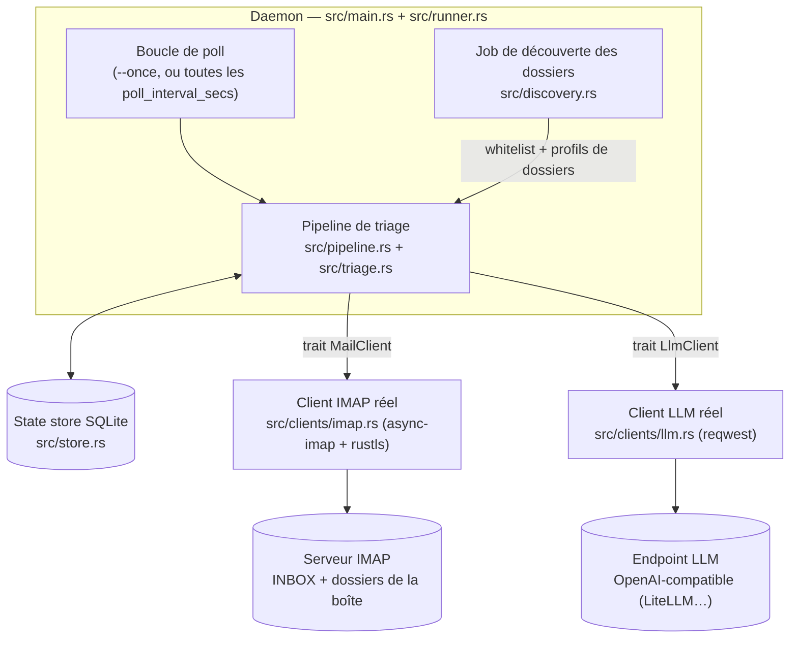

# Architecture

## Vue d'ensemble

Email Zero est un daemon headless en Rust. Pour chaque boîte configurée, il poll
INBOX en IMAP, fait évaluer les nouveaux mails par un LLM (endpoint
OpenAI-compatible) et écrit le tri directement dans les dossiers IMAP de la boîte.
Le client mail habituel reste l'interface unique : pas d'UI.



Les frontières externes passent par des traits injectés (`src/ports.rs`) :
`MailClient` (toutes les opérations IMAP) et `LlmClient` (toutes les requêtes LLM).
En production, les clients réels de `src/clients/` sont branchés ; en test, des fakes
in-memory ou des mini-serveurs sur loopback.

## Modules de `src/`

| Module | Responsabilité |
|--------|----------------|
| `src/main.rs` | CLI (`--config`, `--dry-run`, `--once`, `--refresh-folders`), logging JSON, warning « mot de passe en clair », amorçage de la boucle daemon. |
| `src/runner.rs` | Boucle daemon : poll de chaque boîte avec reconnexion à chaque itération, déclenchement du job de découverte quand il est dû (`--refresh-folders` force). Une boîte en échec est loguée mais ne tue pas le daemon. |
| `src/pipeline.rs` | Pipeline de triage : `SEARCH UNSEEN` → dédup via le state store → batchs LLM en structured output (`BATCH_SCHEMA` v2) réassociés par `uid` → décision → `copy`/`move` (rien en `--dry-run`) → persistance `processed` + `triage_result`. |
| `src/triage.rs` | Logique de décision pure : contrat de triage v2, routage (meilleur candidat de la whitelist), seuil de confiance, `TriageAction` (`none`/`copy`/`move`/`dry_run`). |
| `src/discovery.rs` | Job de découverte des dossiers : `LIST` + attributs special-use RFC 6154, exclusions configurables, échantillonnage des derniers headers (`SEARCH ALL` + `BODY.PEEK[HEADER]`), **une seule requête LLM** de profilage par boîte (`PROFILING_SCHEMA`, prompt `prompts/discovery.md`), profils mis en cache dans `folder`. |
| `src/store.rs` | State store SQLite : tables `mailbox` / `folder` / `processed` / `triage_result` / `discovery_run`, gestion de l'`UIDVALIDITY` (changement = retraitement du dossier). |
| `src/config.rs` | Parsing et validation du TOML, références de secrets (`password_env` / `password_cmd` / `password`), `Debug` masqué des champs secrets. |
| `src/ports.rs` | Traits injectés `MailClient` / `LlmClient` et types échangés (`Folder`, `MailHeader`, `ParsedMail`, `JsonChatRequest`…). |
| `src/clients/imap.rs` | Client IMAP réel (`async-imap` + rustls + racines webpki) : fetchs en `BODY.PEEK[]` pour ne jamais poser `\Seen`, `UIDVALIDITY` lu sur la réponse SELECT. |
| `src/clients/llm.rs` | Client LLM réel (`reqwest`) : `POST {base_url}/chat/completions`, validation de `base_url` (https exigé, loopback et `host.docker.internal` exceptés). |
| `src/retry.rs` | Backoff exponentiel configuré (`max_attempts`, `backoff_base_secs`), fonction pure testable sans dormir. |
| `src/error.rs` | Type d'erreur unique (`thiserror`). |

## Contrat de triage v2 (#21)

Le LLM reçoit un batch de mails (whitelist des dossiers avec description et
exemples + mails avec leur `uid`) et répond en JSON strict (`BATCH_SCHEMA` v2) :
un verdict par mail, chaque verdict portant la **liste ordonnée des dossiers
plausibles** (`candidates`, au moins un élément, ordonnés par confiance décroissante).

Routage appliqué côté Rust (`src/triage.rs`), pour chaque mail :

- **Meilleur candidat de la whitelist retenu** : confiance maximale, à égalité le
  premier de la liste (`MeilleurCandidat`).
- Meilleur candidat sous le seuil configuré, ou aucun candidat de la whitelist :
  le mail reste dans INBOX (`SeuilNonAtteint`).
- Validation **tolérante** de la réponse LLM — jamais d'échec de poll :
  - `uid` inconnu du batch → verdict écarté (`UidInconnuEcarte`) ;
  - deux verdicts pour un même `uid` → candidats fusionnés (`DoublonFusionne`) ;
  - `uid` du batch sans verdict → mail laissé en place et marqué traité
    (`PasDeVerdict`).
- La cible doit appartenir à la whitelist (string-match exact côté Rust) : jamais
  de création de dossier, jamais de placement hors liste.
- **Log de routage par mail** : une ligne avec `uid`, destination, confiance,
  nombre de candidats et règle appliquée.

Le prompt de triage v2 vit dans `prompts/triage.md` — c'est un artefact versionné,
isolé du code.

## Stratégie de tests à cinq niveaux

1. **Unitaires** (rapides) : parsing config, logique `UIDVALIDITY`, validation
   whitelist, seuil de confiance.
2. **Intégration** (le cœur) : pipeline complet — fake IMAP rempli de mails, fake
   LLM avec réponses scriptées, assertions sur les actions produites et le contenu
   du state store. Zéro réseau (`tests/pipeline.rs`, `tests/runner.rs`…).
3. **Conformité RFC (CI, boucle locale)** : le vrai client IMAP
   (`src/clients/imap.rs`) contre un vrai serveur — sidecar conteneur
   `dovecot/dovecot:2.3.21.1` **épinglé**, publié sur le loopback uniquement
   (`127.0.0.1:1143`), compte factice, fixtures maildir committées
   (`tests/fixtures/maildir/`), config `tests/dovecot/dovecot.conf`, suite
   `#[ignore]` dans `tests/imap_dovecot.rs`, job CI `imap-dovecot`. Garde d'échec
   explicite : si Dovecot n'écoute pas après 30 s, le job échoue avec les logs du
   conteneur. Objectif : attraper en CI les divergences fake/serveur réel
   (`BODY.PEEK[HEADER]`, `\Seen` jamais posé, COPY/MOVE/UIDVALIDITY) avant le smoke.
4. **E2E LLM (CI, boucle locale)** : le vrai client LLM (`src/clients/llm.rs`)
   contre le vrai proxy LiteLLM utilisé en production — sidecar
   `ghcr.io/berriai/litellm:v1.108.0` **épinglé**, loopback uniquement
   (`127.0.0.1:4000`), configuré en `mock_response` (`tests/litellm/config.yaml`),
   suite `#[ignore]` dans `tests/llm_litellm.rs`, job CI `llm-litellm`. Garde
   d'échec explicite après 60 s. Surface d'API réelle (bearer, codes d'erreur natifs
   du proxy 400/429/500, format de réponse) sans fournisseur, sans réseau externe,
   sans secret : `mock-ok` (batch complet), `mock-missing-verdict` (uid en
   double/omis, contrat v2) et un test pipeline (fake IMAP + proxy réel). Objectif :
   attraper en CI les divergences fake/proxy réel sur la réponse LLM.
5. **Smoke réel (manuel, hors CI)** : `--dry-run --once` contre les vraies boîtes
   (Orange, Proton via Bridge). Jamais d'écriture en CI, jamais de secret dans les
   tests.

Commandes :

```sh
cargo test                                      # niveaux 1 + 2
cargo test --test imap_dovecot -- --ignored     # niveau 3 (sidecar Dovecot requis)
cargo test --test llm_litellm -- --ignored      # niveau 4 (sidecar LiteLLM requis)
```

Chaque test est nommé d'après une décision de la spec design. CI dès le jour 1 :
`cargo fmt --check`, `cargo clippy --all-targets -- -D warnings`, `cargo test` —
aucun merge avec un warning.

## Décisions d'architecture clés

Renvoi à la [spec design v1](superpowers/specs/2026-11-01-email-zero-design.md) pour
le raisonnement complet :

- **Dossiers IMAP comme interface**, pas de labels custom : les dossiers se
  comportent pareil chez tous les fournisseurs.
- **« Non traité » plutôt que « nouveau »** : `SEARCH UNSEEN` à chaque poll, dédup
  par les UIDs déjà traités dans le state store, `UIDVALIDITY` stocké par dossier
  (changement = retraitement).
- **Structured output plutôt que tool calling** : une requête par batch de mails,
  pas de round-trips, et la liste des dossiers dans le prompt sert de whitelist
  naturelle contre les placements douteux.
- **Action `copy` par défaut** : `move` — le vrai comportement voulu à terme —
  s'active par un changement de config.
- **Pull d'abord** (poll toutes les N minutes), architecture prête pour IDLE.

## Décisions et écarts d'implémentation

Écarts actés par rapport au plan initial (le plan d'implémentation a été supprimé
après cette migration ; la traçabilité vit désormais dans les issues et les PRs) :

- **Crate unique** au lieu d'un workspace à plusieurs crates : pour un POC, moins de
  cérémonie et une compilation plus rapide. Écart endossé.
- **Durcissement des secrets** : `Debug` custom sur `MailboxConfig` masquant les
  champs secrets (`***`, test de rédaction dans `tests/secrets.rs`) ; lecture de
  l'env **injectée** dans `resolve_password(&dyn Fn(&str) -> Option<String>)` (aucun
  `std::env::set_var`/`unsafe` dans les tests, qui tournent en parallèle dans le
  même processus) ; `password_cmd` implémenté (`sh -c`, sortie stdout trimmée) ;
  warning « mot de passe en clair » branché au chargement de la config dans `main`.
- **`BODY.PEEK[]` partout** : jamais de `\Seen` posé, ni sur les headers ni sur le
  corps (fetch de l'échantillonnage de découverte inclus).
- **`base_url` https exigé hors loopback** — la clé API part en bearer — **et
  `host.docker.internal` désormais accepté en http** (fix compose : `extra_hosts`
  `host-gateway`, `config.toml` ajouté au `.gitignore`). `127.0.0.1` / `localhost`
  / `::1` restent acceptés en http pour les tests et les proxys locaux.
- **Pas de `rustfmt.toml` / `clippy.toml`** : les defaults suffisent. Non bloquant.

## Notes techniques différées

- `Store::pending_uids` fait un COUNT par UID (N+1) : OK à l'échelle POC d'une
  boîte perso, à rebattre en un seul `IN (...)` si le backfill historique (v2)
  arrive.
- Backfill de l'historique via API Batch : **option v2** — latence ~24 h
  incompatible avec le tri à la réception, mais économie réelle sur un gros
  volume ; hors de la boucle de tri.
